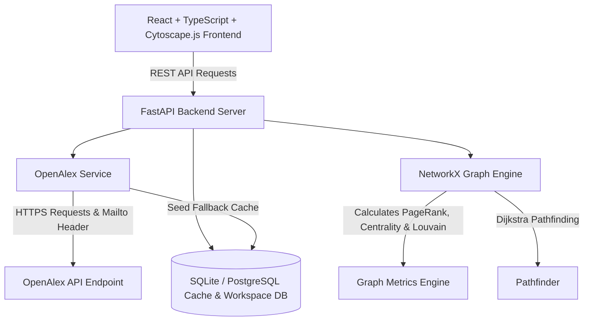

# RESEARCHGRAPH — Architecture Document

## System Architecture

## Data Model

- **Nodes ($V$)**:
  - `Paper`: Title, Year, Venue, Citation Count, DOI.
  - `Author`: Name, Affiliated Institution, Citation Influence.
  - `Institution`: Display Name, Country.
  - `Topic`: Field name, Sub-topics.
- **Edges ($E$)**:
  - `cites`: Directed arc $P_1 \rightarrow P_2$.
  - `authored`: Directed arc $A_1 \rightarrow P_1$.
  - `affiliated_with`: Directed arc $A_1 \rightarrow I_1$.
  - `has_topic`: Directed arc $P_1 \rightarrow T_1$.
  - `collaborates_with`: Undirected edge $A_1 \leftrightarrow A_2$ with co-authorship weights.
