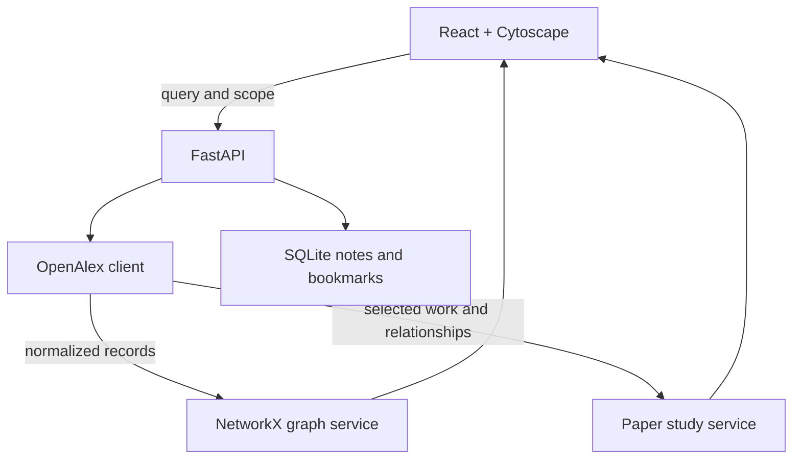

# ResearchGraph architecture

OpenAlex is the scholarly source. Works retain their OpenAlex ID and source URL. Graph expansion is bounded, deduplicated, and uses only retrieved records. A citation `A → B` means that work A lists work B in `referenced_works`. Authorship, affiliation, topic, and related-work edges remain separate relationship types.

SQLite stores personal notes and bookmarks in `backend/researchgraph.db`. External records are fetched from OpenAlex; network errors are returned to the UI and do not switch to sample records. Network measures are calculated over the currently retrieved graph and do not indicate scientific quality.
